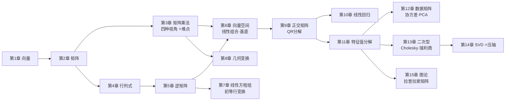

# 🗺️ 全书地图：15 章知识依赖

> [!abstract] 怎么用这张地图
> 箭头表示「**先学过 A，再学 B 才顺**」。每张卡片都可以点击跳转。
> 想走最短路径，就顺着 [[02-学习路线图与节奏|学习路线图]] 里的主线走。

> [!note] Mermaid 不显示？
> 上图需要 Obsidian 自带渲染（一般默认可用）。若看不到，直接看下面的表格。

## 三条学习主线

| 主线 | 路径 | 学完能做什么 |
| --- | --- | --- |
| **A 最小可用线**（新手必走） | 01 → 02 → 03 → 04 → 05 → 06 → 07 | 看懂矩阵算式，会解线性方程组，建立几何直觉 |
| **B 数据科学线** | A + 09 → 10 → 11 → 12 → 14 | 手写最小二乘、PCA、SVD 降维，理解它们的来龙去脉 |
| **C 图形与图论线** | A + 08 → 09 → 14 → 15 | 明白旋转/缩放/投影矩阵、谱聚类、拉普拉斯矩阵 |

## 15 章一览

| 章 | 主题（中） | 主题（英） | 难度 | 前置 | 代码 |
| --- | --- | --- | --- | --- | --- |
| [[第1章-向量|第1章]] | 向量 | Vectors | 入门 | — | 26 |
| [[第2章-矩阵|第2章]] | 矩阵 | Matrices | 入门 | 01 | 7 |
| [[第3章-矩阵乘法的四种视角|第3章]] | 矩阵乘法的四种视角 | Four Views of Matrix Multiplication | 核心·难点 | 02 | 11 |
| [[第4章-行列式|第4章]] | 行列式 | Determinants | 入门 | 02 | 3 |
| [[第5章-逆矩阵|第5章]] | 逆矩阵 | Inverse Matrices | 入门 | 04 | 4 |
| [[第6章-向量空间·线性组合与基底|第6章]] | 向量空间·线性组合与基底 | Vector Space, Linear Combination & Basis | 核心 | 01、02、03、05 | 4 |
| [[第7章-线性方程组与初等行变换|第7章]] | 线性方程组与初等行变换 | Linear Systems & Elementary Row Operations | 核心 | 05 | 6 |
| [[第8章-几何变换|第8章]] | 几何变换 | Geometric Transformations | 入门 | 03 | 3 |
| [[第9章-正交矩阵与QR分解|第9章]] | 正交矩阵与QR分解 | Orthogonal Matrices & QR Decomposition | 进阶 | 01、03、06 | 4 |
| [[第10章-线性回归|第10章]] | 线性回归 | Linear Regression | 进阶·实战 | 01、06、09 | 7 |
| [[第11章-特征值分解|第11章]] | 特征值分解 | Eigenvalue Decomposition | 进阶·难点 | 04、06、09 | 1 |
| [[第12章-数据矩阵·协方差与PCA|第12章]] | 数据矩阵·协方差与PCA | Data Matrix, Covariance & PCA | 进阶·实战 | 11 | 4 |
| [[第13章-二次型·Cholesky·瑞利商|第13章]] | 二次型·Cholesky·瑞利商 | Quadratic Forms, Cholesky & Rayleigh Quotient | 进阶 | 11、12 | 0 |
| [[第14章-奇异值分解SVD|第14章]] | 奇异值分解SVD | Singular Value Decomposition | 高阶·压轴 | 11、13 | 1 |
| [[第15章-图论与拉普拉斯矩阵|第15章]] | 图论与拉普拉斯矩阵 | Graphs & Laplacian Matrix | 高阶·专题 | 11、14 | 7 |

## 名词对照（中文 ↔ English）

| 中文 | English | 出现在 |
| --- | --- | --- |
| 向量 / 标量 / 内积 | vector / scalar / inner product | 第 1 章 |
| 范数（L1、L2、L∞） | norm | 第 1 章 |
| 转置 / 形状 | transpose / shape | 第 2 章 |
| 分块矩阵乘法 | block matrix multiplication | 第 3 章 |
| 行列式 | determinant | 第 4 章 |
| 逆矩阵 / 伴随矩阵 | inverse / adjugate | 第 5 章 |
| 向量空间 / 线性组合 / 基底 | vector space / linear combination / basis | 第 6 章 |
| 初等行变换 | elementary row operations | 第 7 章 |
| 仿射变换 / 剪切 / 镜像 | affine transformation / shear / reflection | 第 8 章 |
| 正交矩阵 / 格拉姆-施密特正交化 / QR 分解 | orthogonal matrix / Gram–Schmidt / QR decomposition | 第 9 章 |
| 线性回归 / 最小二乘 | linear regression / least squares | 第 10 章 |
| 特征值分解（EVD）/ 谱分解 | eigenvalue decomposition / spectral decomposition | 第 11 章 |
| 协方差矩阵 / 主成分分析（PCA） | covariance matrix / principal component analysis | 第 12 章 |
| 二次型 / 正定性 / 瑞利商 | quadratic form / positive definiteness / Rayleigh quotient | 第 13 章 |
| 奇异值分解（SVD）/ 截断 SVD | singular value decomposition / truncated SVD | 第 14 章 |
| 邻接矩阵 / 度矩阵 / 拉普拉斯矩阵 / 谱聚类 | adjacency / degree / Laplacian / spectral clustering | 第 15 章 |

---

导航：[[线性代数不难·导读|🏠 总览]] · [[02-学习路线图与节奏|📅 学习路线图]]
